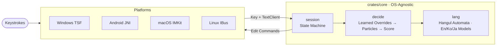

<p align="center">
  
</p>

<h1 align="center">Typescript</h1>

<h3 align="center">
Intelligent, automatic multilingual input method editor (IME) for English, Korean, and Japanese — without toggling a language key.
</h3>

<p align="center">
  <a href="README.md">한국어</a> &bull; <b>English</b> &bull; <a href="docs/">Documentation</a>
</p>

<p align="center">
  <a href="#installation"><b>Installation</b></a> &bull;
  <a href="#how-to-use"><b>Usage</b></a> &bull;
  <a href="#configuration"><b>Configuration</b></a> &bull;
  <a href="#japanese-support"><b>Japanese</b></a> &bull;
  <a href="#app-compatibility"><b>App Compatibility</b></a> &bull;
  <a href="#architecture--development"><b>Architecture</b></a> &bull;
  <a href="#known-limitations"><b>Limitations</b></a>
</p>

<p align="center">
  <a href="https://github.com/iamallyouneed/Typescript/releases/latest"></a>
  <a href="https://github.com/iamallyouneed/Typescript/actions/workflows/ci.yml"></a>
  
  
  
  
  
  
</p>

---

```
dkssudgktpdy, hello world!          →  안녕하세요, hello world!
dlrjs githubdp commitgkf rjdi       →  이건 github에 commit할 거야
fltpssm ghkdlxld                    →  리센느 화이팅
kyouhaiitenkidesune ⏎               →  きょうはいいてんきですね   (Japanese pack)
```

Type naturally on a standard QWERTY keyboard. Typescript analyzes keystrokes **word-by-word**, scoring whether you intended English, Korean (2-set Hangul), or Japanese (Romaji), and converts it seamlessly on the fly. Made a mistake? A single tap on `Esc` cycles through candidate readings, and repeating a correction twice teaches Typescript your preference.

## Features

- **Word-Level Automatic Language Detection.** Evaluates character trigrams and dictionary frequencies to score English and Korean, factoring in preceding word context and confidence scores.
- **Live Underlined Previews.** Dotted underlines show the current prediction in real-time, mirroring what `Space` or `Enter` will commit.
- **Seamless Esc Cycling.** Rotates through: English → English + Korean Particle (`github에`) → Korean → Japanese. Works even immediately after committing a word.
- **Mixed Compounds.** Automatically separates English stems with attached Korean particles/endings (`githubdp` → `github에`).
- **Per-Application Rules.** Strict thresholding in terminals, pass-through in games, and native Esc pass-through in editors (`apps.json`).
- **Ultra Lightweight.** Precalculated statistical tables are packed into zero-copy, memory-mapped **language packs**. The background DLL footprint remains under 1MB.
- **Single Core Across Windows, Android, macOS, and Linux.** All decision logic resides in an OS-independent Rust core (`crates/core`). Native platform adapters translate raw keystrokes into unified editing commands.

| | Windows | Android | macOS | Linux |
| --- | --- | --- | --- | --- |
| **Format** | TSF Text Service (x64 + x86 DLL) | `InputMethodService` APK (arm64) | InputMethodKit app (`Typescript.app`) | IBus Engine (`ibus-engine-typescript`) |
| **Input** | Physical keyboard | Virtual keyboard + BT/USB | Physical keyboard | Physical keyboard |
| **EN & KO** | Supported | Supported | Supported | Supported |
| **Autocomplete (Tab) & Learning** | Supported | N/A (handled by OS) | N/A | N/A |
| **Japanese** | Optional pack (`-Japanese`) | N/A | Optional pack (`--languages ko,en,ja`) | Optional pack (`--languages ko,en,ja`) |
| **Pause Hotkey** | Hangul key | Hangul key | Option + Space | Hangul / Pause |

## Installation

### Windows

Run the following in PowerShell (requires one UAC administrator confirmation):

```powershell
irm https://github.com/iamallyouneed/Typescript/releases/latest/download/install.ps1 | iex
```

An interactive menu lets you pick your languages and define the `Esc` rotation order. You can also specify arguments directly:

```powershell
$i = [scriptblock]::Create((irm https://github.com/iamallyouneed/Typescript/releases/latest/download/install.ps1))
& $i -Languages ko,en,ja     # Explicit language cycle order
& $i -Japanese               # Enable the Japanese language pack
& $i -Uninstall              # Remove the text service (retains configuration)
& $i -Version v0.5.0         # Install a pinned release
```

After installation, press **Win + Space** to choose the input method:
- **`Typescript (Autocomplete)`**: Auto-detection + Tab autocomplete + vocabulary learning.
- **`Typescript`**: Pure auto-detection without recording word history.

### macOS & Linux

Install with a single command (installs locally for the current user, no root required):

```sh
curl -fsSL https://github.com/iamallyouneed/Typescript/releases/latest/download/install.sh | sh
```

- **macOS:** Installs to `~/Library/Input Methods/Typescript.app`. Log out, log back in, and add **Typescript** under System Settings → Keyboard → Input Sources.
- **Linux:** Installs the IBus engine to `~/.local/share/typescript/`. Restart IBus (`ibus restart`) and add **Typescript** in your desktop settings.

### Android

Download **`typescript.apk`** from [GitHub Releases](https://github.com/iamallyouneed/Typescript/releases/latest), install it, and enable **Typescript** under Android Settings → Languages & Input → On-Screen Keyboard.

## How to Use

| Keystroke | Behavior |
| --- | --- |
| Alphanumeric keys | Continue composing current word. Dotted underline shows live prediction |
| Space, Punctuation | Commits current word and forwards key to the application. In Japanese words, Space opens Kanji candidate conversion |
| Enter | Confirms composing text without inserting a newline in the host application |
| Esc | Cycles candidate readings: English → English + Particle → Korean → Japanese |
| Shift + Esc | Force cycles reading in any application (even when `escapeToApp` is active) |
| Esc right after commit | Undoes commit and cycles the word just typed. Repeating this twice commits the preference to memory |
| Backspace | Decomposes Hangul syllables into jamo; deletes characters in English |
| Tab | (Autocomplete profile) Autocompletes word from frequency history or built-in dictionary |
| Hangul / Pause Key | Pauses/resumes Typescript for the active text field |

## Japanese Support

Enable the Japanese language pack to seamlessly type Romaji and convert to Kana and Kanji:

```
kyouhaiitenkidesune ⏎   →  今日はいい天気ですね
kyouhagoogledekensaku ⏎ →  今日はgoogleで検索   (preserves embedded English words)
```

- **Space opens Kanji conversion**: Select candidates using Space / Down (next), Up (previous), 1–9 number keys, or Enter (confirm).
- **Dictionary**: Built on the IPADIC dictionary (390k lexical entries and connection costs) calibrated with `wordfreq` Zipf metrics.
- Candidate selections are dynamically learned per reading under `%APPDATA%\Typescript\kanji_learning.json`.

## Configuration

Settings and user history reside in `%APPDATA%\Typescript\` (Windows) or `~/.config/Typescript/` (Linux). Open the visual dashboard by launching `typescript-config` or clicking **Typescript Settings** in the Start Menu.

### `settings.json`
```json
{
  "languages": ["en", "ko"],
  "returnConfirmsOnly": true,
  "flipKeys": ["Esc", "Hangul"],
  "pauseKeys": ["Alt+Hangul"],
  "autocomplete": true,
  "checkUpdates": true
}
```

### `apps.json`
```json
{
  "*": { "escapeToApp": false },
  "windowsterminal.exe": { "conversionThreshold": 0.97 },
  "code.exe": { "escapeToApp": true },
  "game.exe": { "enabled": false }
}
```

## Architecture & Development



- Read the in-depth documentation in the [**Documentation Hub (docs/)**](docs/README.md).
- To run tests:
  ```powershell
  cargo test
  cargo clippy --all-targets -- -D warnings
  cargo run -p typescript-packgen --bin build-packs -- crates/core/data target/packs
  ```

## Known Limitations

- **macOS & Linux Input Modules**: Built and compiled via CI; extensive community testing is underway.
- **Windows Tray Icon**: Displays as `ENG` because Typescript registers under English (US) to work around legacy Windows IMM32 interim composition truncation bugs.
- **Post-Commit Flip**: Supported only in applications that grant TSF caret text-inspection permissions.

## License

Copyright (C) 2026 [Necessity](https://github.com/iamallyouneed). Licensed under [AGPL-3.0-only](LICENSE).
Third-party dataset licenses and notices are listed in [THIRD_PARTY_NOTICES.txt](THIRD_PARTY_NOTICES.txt).
Contributing guidelines are in [CONTRIBUTING.md](CONTRIBUTING.md).
