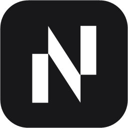
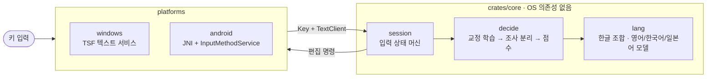

<p align="center">
  
</p>

<h1 align="center">Typescript</h1>

<h3 align="center">
한/영 키 없이, 치는 대로 영어·한국어·일본어를 알아서 가려 주는 입력기
</h3>

<p align="center">
  <b>한국어</b> &bull; <a href="README.en.md">English</a> &bull; <a href="docs/">문서 (Docs)</a>
</p>

<p align="center">
  <a href="#설치"><b>설치</b></a> &bull;
  <a href="#쓰는-법"><b>쓰는 법</b></a> &bull;
  <a href="#언어와-설정-관리"><b>관리</b></a> &bull;
  <a href="#일본어"><b>일본어</b></a> &bull;
  <a href="#설정-apptyped-typescript"><b>설정</b></a> &bull;
  <a href="#앱-호환"><b>앱 호환</b></a> &bull;
  <a href="#구조와-개발"><b>구조와 개발</b></a> &bull;
  <a href="#알려진-한계"><b>알려진 한계</b></a>
</p>

<p align="center">
  <a href="https://github.com/iamallyouneed/Typescript/releases/latest"></a>
  <a href="https://github.com/iamallyouneed/Typescript/actions/workflows/ci.yml"></a>
  
  
  
  
  
  
</p>

---

```
dkssudgktpdy, hello world!          →  안녕하세요, hello world!
dlrjs githubdp commitgkf rjdi       →  이건 github에 commit할 거야
fltpssm ghkdlxld                    →  리센느 화이팅
kyouhaiitenkidesune                 →  きょうはいいてんきですね   (일본어 팩)
```

영어 자판 그대로 치면, **단어마다** 영어인지 한국어(두벌식)인지 일본어(로마자)인지 판단해서 바꿔 줍니다. 틀렸으면 Esc 한 번이면 다른 읽기로 바뀌고, 같은 교정을 두 번 하면 그 단어를 배웁니다.

## 특징

- **단어 단위 자동 판별.** 글자 모델(트라이그램)과 단어 사전으로 영어/한국어를 점수 매기고, 앞 단어의 언어와 확신도를 함께 봅니다.
- **치는 동안 보이는 미리보기.** 점선 밑줄로 현재 판단을 보여 주고, Space/Enter가 확정하는 것과 같은 결과를 미리 보여 줍니다.
- **Esc로 순환.** 영어 → 영어+조사(`github에`) → 한국어 → 일본어. 확정한 직후에도 Esc로 되돌립니다.
- **섞어 쓰기.** `githubdp` → `github에` 처럼 영어 단어 뒤에 조사·어미를 붙여 씁니다.
- **앱마다 다른 규칙.** 터미널에서는 엄격하게, 게임에서는 끄고, 에디터에서는 Esc를 앱에 넘깁니다 (`apps.json`).
- **가볍게.** 모델 테이블은 릴리스 때 미리 계산해 **언어 팩**으로 나눠 두고(앱마다 로드되는 DLL이라 실행 시 계산하지 않습니다), 입력기는 팩을 메모리 맵으로 읽습니다. DLL은 1MB 안쪽이고 언어는 필요한 팩만 받습니다.
- **Windows, Android, macOS, Linux가 같은 코어.** 판별 로직은 OS를 모르는 Rust 코어 하나이고, 플랫폼은 키를 넣고 편집 명령을 받아 적용합니다.

| | Windows | Android | macOS | Linux |
| --- | --- | --- | --- | --- |
| 형태 | TSF 텍스트 서비스 (x64 + x86 DLL) | `InputMethodService` APK (arm64) | InputMethodKit 입력기 (`Typescript.app`, 유니버설) | IBus 엔진 (`ibus-engine-typescript`) |
| 입력 | 물리 키보드 | 화면 키보드 + 블루투스/USB 키보드 | 물리 키보드 | 물리 키보드 |
| 영어·한국어 | 있음 | 있음 | 있음 | 있음 |
| 자동완성(Tab)·단어 학습 | 있음 | 없음 (폰 키보드에 이미 있는 기능) | 없음 | 없음 |
| 일본어 | **일본어 팩** (`-Japanese`) | 없음 | **일본어 팩** (`--languages ko,en,ja`) | **일본어 팩** (`--languages ko,en,ja`) |
| 일시정지 키 | 한/영 | `한/영` 키 | Option+Space | 한/영 (Hangul), Pause |

## 설치

### Windows

PowerShell에서 한 줄이면 최신 릴리스를 받아 설치하고 입력기까지 켭니다 (관리자 권한 확인창 1회). 설치 중에 **쓸 언어를 고르는 화면**이 나옵니다 (Space로 선택, 이어서 Esc로 넘기는 순서를 정합니다).

```powershell
irm https://github.com/iamallyouneed/Typescript/releases/latest/download/install.ps1 | iex
```

화면 없이 바로 정하려면 `-Languages` 를 줍니다. 영어·한국어·일본어 중 1개 이상을 자유롭게 조합하고, 쓴 순서가 Esc 순환 순서입니다 (예: 한국어만, 일본어 → 영어).

```powershell
& ([scriptblock]::Create((irm https://github.com/iamallyouneed/Typescript/releases/latest/download/install.ps1))) -Languages ko,en,ja
```

언어는 팩으로 나뉘어 필요한 것만 받습니다 (영어 0.5MB, 한국어 0.4MB, 일본어 6MB). 팩은 `%LOCALAPPDATA%\Typescript\packs` 에 깔리고, 켜진 언어와 순서는 `settings.json` 의 `languages` 가 정합니다. 설치 뒤의 관리는 아래 [언어와 설정 관리](#언어와-설정-관리)에서 합니다. 이미 설치했다면 같은 명령을 다시 실행해도 됩니다 (켜진 언어는 그대로). 제거와 버전 지정은 스크립트 블록으로 부릅니다.

```powershell
$i = [scriptblock]::Create((irm https://github.com/iamallyouneed/Typescript/releases/latest/download/install.ps1))
& $i -Uninstall            # 제거 (설정과 언어 팩은 남는다)
& $i -Version v0.5.1       # 특정 버전
& $i -Japanese             # 일본어도 켠다 (-Languages 와 같이 쓰면 거기에 더한다)
```

받은 zip은 릴리스의 SHA-256과 맞는지 확인한 뒤에만 설치합니다.

소스에서 직접 빌드해 설치하려면 (Rust와 `rustup target add i686-pc-windows-msvc` 필요):

```powershell
.\scripts\install.ps1            # 빌드(x64 + x86) → 관리자 권한 요청(UAC 1회) → 등록
.\scripts\install.ps1 -Japanese  # 일본어 팩도 설치하고 켠다
.\scripts\install.ps1 -Uninstall # 제거
```

설치 후 **Win+Space** 로 입력기를 고릅니다. 언어 목록에서는 **영어(미국)** 아래에 있습니다 (없으면 설치가 영어(미국)을 추가합니다). 한국어 아래에 두면 카카오톡 같은 IMM32 앱에서 Windows가 조합을 한 글자로 잘라 버리기 때문입니다 ([앱 호환](#앱-호환) 참고). 입력기는 둘입니다.

| 입력기 | 하는 일 |
| --- | --- |
| `Typescript (자동완성)` | 자동 판별 + Tab 자동완성 + 쓴 단어 학습 |
| `Typescript` | 자동 판별만 (자동완성도, 단어 기록도 없다) |

이미 떠 있는 앱은 다시 열어야 새 입력기를 읽습니다. 아이콘은 `assets/icon.png` 를 바꾸고 `.\scripts\make-icon.ps1` 후 다시 설치하면 됩니다.

### macOS와 Linux

한 줄로 설치합니다 (현재 사용자에게만 설치하고 관리자 권한은 필요 없습니다. 릴리스를 받아 SHA-256을 확인합니다).

```sh
curl -fsSL https://github.com/iamallyouneed/Typescript/releases/latest/download/install.sh | sh
# 언어를 고르거나 제거할 때:
curl -fsSL https://github.com/iamallyouneed/Typescript/releases/latest/download/install.sh | sh -s -- --languages ko,en,ja
curl -fsSL https://github.com/iamallyouneed/Typescript/releases/latest/download/install.sh | sh -s -- --uninstall
```

- **macOS:** `~/Library/Input Methods/Typescript.app` 로 설치됩니다. 로그아웃했다가 다시 들어온 뒤 시스템 설정 → 키보드 → 입력 소스 → 편집에서 **Typescript** 를 추가합니다. 서명·공증을 하지 않아 처음에는 개인정보 보호 및 보안에서 허용해야 할 수 있습니다. 한/영 키가 없으니 **Option+Space** 가 일시정지입니다. 앱별 규칙의 키는 앱 번들 ID의 마지막 부분(소문자, 예: `terminal`)입니다.
- **Linux:** IBus 엔진이 `~/.local/share/typescript/` 에, 컴포넌트가 `~/.local/share/ibus/component/` 에 설치됩니다. 설정 → 키보드 → 입력 소스(또는 `ibus-setup`)에서 **Typescript** 를 추가합니다. 목록에 없으면 로그아웃했다가 다시 들어오세요. IBus는 입력 중인 앱의 이름을 알려 주지 않아 앱별 규칙은 기본 규칙만 적용됩니다. fcitx5는 아직 지원하지 않습니다.
- 설정은 macOS에서 `~/Library/Application Support/Typescript/`, Linux에서 `~/.config/Typescript/`(언어 팩은 `~/.local/share/Typescript/packs/`)에 저장됩니다. `typescript-config` 로 언어·설정·앱 규칙·업데이트를 관리하는 방법은 아래와 같습니다 (`~/.local/bin` 이 PATH에 있어야 합니다).

### Android

릴리스의 **`typescript.apk`** 를 받아 설치합니다 (출처를 알 수 없는 앱 허용 필요). 설정 → 키보드 목록에서 **Typescript** 를 켜고, 입력창에서 키보드로 고릅니다.

- 화면 키보드는 안드로이드 기본 `KeyboardView` 에 두벌식 자모를 키마다 같이 표시합니다. 블루투스/USB 물리 키보드도 됩니다.
- 화면 키보드의 `가/A` 키는 Esc와 같습니다 (치는 중인 단어, 또는 방금 친 단어의 언어를 순환). `한/영` 키는 일시정지이고 켜져 있으면 `OFF` 로 보입니다.
- 비밀번호 칸과 텍스트가 아닌 칸에서는 판별 없이 글자만 넣습니다.
- 릴리스 APK는 고정된 릴리스 키로 서명돼서 새 버전을 덮어 설치할 수 있습니다.

<details>
<summary>APK 직접 빌드</summary>

```powershell
.\platforms\android\build.ps1                 # platforms\android\build\typescript.apk (arm64 + x86_64)
.\platforms\android\build.ps1 -Abi arm64-v8a  # 폰용만
adb install -r platforms\android\build\typescript.apk
```

Android SDK(build-tools, platform 34), NDK, JDK 17, `rustup target add aarch64-linux-android x86_64-linux-android`, `cargo install cargo-ndk` 가 필요합니다. Gradle은 쓰지 않습니다.

직접 빌드하면 디버그 키로 서명되므로 릴리스 APK와는 덮어 설치되지 않습니다. 릴리스 키로 서명하려면 `TS_KEYSTORE`, `TS_KEYSTORE_PASS` 환경변수에 키스토어 경로와 비밀번호를 주세요 (별칭은 `typescript`). 릴리스 키는 GitHub Secrets `ANDROID_KEYSTORE_BASE64`, `ANDROID_KEYSTORE_PASSWORD` 에 있습니다.

</details>

## 언어와 설정 관리

설치 뒤에는 시작 메뉴의 **Typescript 설정** (또는 `C:\Program Files\Typescript\typescript-config.exe`)이 브라우저에 설정 페이지를 엽니다. 이 컴퓨터(127.0.0.1)에서만 열리고, 실행할 때마다 바뀌는 토큰이 주소에 들어 있어 다른 사이트는 접근할 수 없습니다. 탭을 닫으면 잠시 뒤 스스로 끝납니다.

- **언어**: 켜기·끄기(끌 때 그 팩도 지웁니다, 마지막 하나는 못 끕니다), Esc 순서 바꾸기, 팩 받기. 새 언어는 레포의 릴리스에 올라오는 대로 목록에 나타납니다.
- **입력 설정**: Enter 동작, 자동완성, 일시정지 키, 일본어 옵션 (일본어를 켰을 때만 보입니다).
- **앱별 규칙**: `apps.json` 을 표로 편집합니다 (터미널은 변환 기준 엄격, 게임은 끄기 등).
- **업데이트**: GitHub 릴리스에서 새 버전을 확인합니다. 언어 팩은 관리자 권한 없이 갱신되고, 프로그램 자체는 릴리스의 설치기를 실행합니다 (확인창 1회).

같은 일을 명령으로도 할 수 있습니다.

```powershell
typescript-config list                 # 설치됨 / 받을 수 있음 / 켜짐 순서
typescript-config add ja               # 일본어 팩을 받고 켠다
typescript-config remove ja            # 끄고 팩을 지운다
typescript-config order ko,en          # Esc 순서 (켜진 언어끼리만 바꿀 수 있다)
typescript-config check                # 새 버전이 있는지
typescript-config update               # 언어 팩 갱신 + 새 프로그램 설치기 실행
typescript-config setup --languages ko,en   # 설치 때 쓰는 선택 (화면 없이)
```

받은 팩은 릴리스 목록(`packs.json`)의 SHA-256과 크기가 맞고, 안의 표 파일이 manifest의 해시와 맞을 때만 설치됩니다. 하루에 한 번 새 릴리스를 확인해 알려 주며(`settings.json` 의 `"checkUpdates": false` 로 끕니다), `TYPESCRIPT_RELEASE` 에 폴더나 주소를 주면 다른 릴리스(오프라인 설치)를 씁니다.

## 쓰는 법

| 키 | 동작 |
| --- | --- |
| 글자 | 단어를 이어 간다. 점선 밑줄로 현재 판단을 보여 준다 |
| Space, 구두점 | 단어를 확정하고 키는 앱이 그대로 받는다. 일본어 단어에서는 Space가 변환을 연다 ([일본어](#일본어)) |
| Enter | 밑줄 단어를 확정만 한다 (다음 Enter가 앱의 것). 일본어 단어는 어느 설정에서도 확정만 한다 |
| Esc | 읽기를 순환: 영어 → 영어+조사 → 한국어 → 일본어(켰을 때) |
| Shift+Esc | 어느 앱에서나 읽기를 순환 |
| 확정 직후 Esc | 방금 확정한 단어를 다음 읽기로 바꾼다. 같은 교정을 두 번 하면 학습한다 |
| Backspace | 영어는 글자 단위, 한국어는 두벌식처럼 자모 → 음절 단위, 일본어는 가나 한 글자 |
| ⌃K / F7, ⌃J / F6 | (일본어) 읽기를 가타카나 / 히라가나로 보여 준다. Space로 둘을 뒤집고 Enter로 확정한다 |
| Tab | (자동완성 입력기) 쓰는 중인 단어를 자주 쓴 단어로 완성한다. 내가 친 단어가 먼저고, 없으면 내장 사전이다. 완성될 단어는 단어 아래의 작은 알약 모양 창에 `안녕하세요  Tab`으로 미리 보인다 (앱 테마에 맞춰 라이트/다크). 완성할 게 없으면 단어만 확정하고 Tab은 앱으로 간다 |
| **한/영 키** | 이 텍스트 필드에서 Typescript를 끄고 켠다 (다른 칸으로 가면 다시 켜진다) |

## 일본어

> **일본어 팩**이 설치되어 있어야 됩니다. 팩이 없으면 `languages` 에 `"ja"` 가 있어도 그 언어는 빠지고 나머지로 동작합니다.

일본어 팩을 설치하면 켜지고, `settings.json` 의 `languages` 에서 `"ja"` 를 빼면 꺼집니다. 공백 없이 친 로마자를 단어마다 일본어로 읽을지 판단해 가나로 보여 주고 (점선 밑줄), Esc 순환과 확정 규칙은 영어/한국어와 같습니다.

```
kyouhaiitenkidesune ⏎   →  今日はいい天気ですね
kyouhagoogledekensaku ⏎ →  今日はgoogleで検索   (문구 안 영어 단어는 그대로)
```

- **Space가 변환을 엽니다.** 후보를 Space/↓(다음), ↑(이전), 1–9, Enter(확정)로 고르고, Esc/Backspace는 가나 편집으로 돌아갑니다. ←/→는 첫 구절의 경계를 늘리고 줄입니다.
- **한자 변환**은 IPADIC 사전(39만 항목 + 연결 비용, NAIST 라이선스)으로 하고, 단어 비용은 wordfreq 빈도로 보정합니다 (사전 데이터 ~16MB가 DLL에 함께 실리고 쓰일 때만 읽힙니다). Space 후보로 전체 읽기의 여러 경로·첫 구절 경계·가나/카타카나가 나오고, 고른 후보는 읽기별로 학습합니다 (`%APPDATA%\Typescript\kanji_learning.json`, 읽기당 5개).
- 품질은 Mozc·Apple 엔진보다 낮습니다. 첫 후보가 틀리면 Space로 넘기면 되고(예: `ほん` → ホン, 本 순서), 같은 교정을 두 번 하면 다음부터 먼저 나옵니다.
- `"liveConversion": true` 면 치는 동안 첫 후보를 바로 보여 줍니다 (macOS판 라이브 변환: `きょうは…` → 今日は…).
- `"fullWidthDigits"`, `"fullWidthSpace"` (둘 다 기본 꺼짐): 일본어 뒤의 숫자와 공백을 전각으로 (０３－１２３４, 　). `apps.json` 의 `"fullWidth": false` 로 그 앱에서만 반각으로 둘 수 있습니다 (터미널).
- 문구 안에서 `, . ? ! -` 는 、。？！ー 로 붙고, 일본어 뒤의 기호는 스스로 한 단어가 되어 Return이나 다음 단어가 확정합니다.
- 사전 데이터를 다시 만들려면 `tools/build_ipadic.py` (IPADIC 원본과 wordfreq zipf JSON이 필요합니다 — 도구 설명 참고).

## 설정 (`%APPDATA%\Typescript\`)

JSON을 직접 편집합니다. 앱 간 전환할 때 다시 읽습니다.

`settings.json`

```json
{ "returnConfirmsOnly": true, "pauseKey": "hangul", "autocomplete": true,
  "languages": ["en", "ko"], "liveConversion": false, "fullWidthDigits": false, "fullWidthSpace": false }
```

| 키 | 뜻 |
| --- | --- |
| `autocomplete` | `false`면 `Typescript (자동완성)` 에서도 Tab 자동완성과 단어 기록을 끈다 |
| `pauseKey` | `"hangul"`(한/영 키) 또는 `"off"` |
| `checkUpdates` | `false`면 새 릴리스를 자동으로 확인하지 않는다 (기본 켜짐) |
| `languages` | 켜진 언어와 Esc 순환 순서. `"en"` `"ko"` `"ja"` 중 1개 이상, 자유 조합 (한국어만, 일본어만도 된다). 예전 `"japanese": true` 만 있는 파일은 `["en","ko","ja"]` 로 읽는다. 팩이 없는 언어는 빠진다 |
| `liveConversion`, `fullWidthDigits`, `fullWidthSpace` | 일본어 절에서 설명한다 |

**단어 학습** — 자동완성 입력기에서 확정한 영어/한글 단어를 `user_history.json` 에 셉니다. **2번 이상 친 단어만** 제안합니다 (한 번 친 비밀번호·오타는 나오지 않습니다). 10단어마다, 그리고 입력칸을 옮길 때 파일에 쓰고 다시 읽으므로 다른 앱에서 배운 단어도 곧 제안됩니다. 숫자나 영한 섞인 토큰, 1글자는 기록하지 않습니다.

`apps.json` — 키는 **exe 파일 이름**(대소문자 무시). `"*"` 는 기본값이고, 앱 항목에는 다른 키만 적습니다.

```json
{ "*": { "escapeToApp": false },
  "windowsterminal.exe": { "conversionThreshold": 0.97 },
  "game.exe": { "enabled": false } }
```

| 키 | 뜻 |
| --- | --- |
| `enabled: false` | 키를 그대로 통과 (영문 입력) |
| `conversionThreshold` | 기본 0.5. 0.97(엄격)은 터미널에서 짧은 명령이 한글로 바뀌는 것을 막는다 |
| `escapeToApp: true` | Esc를 앱에 넘기고 Shift+Esc로 읽기를 바꾼다 (에디터) |
| `useSystemIme: true` | 그 앱에서는 시스템 한국어 입력기로 넘긴다 (한/영 키로 전환. [앱 호환](#앱-호환)) |
| `fullWidth: false` | (일본어) 그 앱에서는 전각 숫자·공백을 반각으로 둔다 (터미널) |

`lexicon.json` — 교정으로 배운 단어 (직접 고쳐도 됩니다).

## 앱 호환

- **카카오톡, RichEdit 기반 앱 (IMM32 앱).** Windows는 TSF 입력기의 조합을 IMM32 메시지로 바꿔 주는데, *한국어* 입력기에는 "조합은 한 글자(interim)" 규칙을 적용해 나머지를 바로 확정합니다. 단어 전체를 미리보기로 보여 주는 이 입력기는 한국어로 등록하면 키마다 끊겼습니다 (`테스트` → `ㅌpㅅmㅌm`). 그래서 **영어(미국)로 등록합니다.** 그러면 같은 앱에서도 단어 전체가 하나의 조합으로 유지됩니다. 또 IMM32 앱은 입력기가 "가져가겠다"고 한 키를 돌려받지 못하므로, 단어를 끝내고 앱으로 넘어가는 키(Space, 구두점, Enter, Tab, 방향키)는 TSF가 키를 물어보는 단계에서 바로 처리합니다.
- **시스템 한국어 입력기를 쓰고 싶은 앱.** `apps.json` 에 `{ "앱.exe": { "useSystemIme": true } }` 로 그 프로세스만 Microsoft 한국어 IME로 넘길 수 있습니다 (다른 앱으로 가면 되돌아옵니다).
- **문제를 볼 때.** `%APPDATA%\Typescript\debug.on` 파일을 만들면 같은 폴더의 `debug.log` 에 이벤트 이름(포커스 이동, 조합 시작, 앱이 조합을 끝냄)만 남습니다. 친 글자는 기록하지 않습니다. 확인이 끝나면 파일을 지우세요.
- `cargo run -p typescript-tip --example richedit_lab -- --ts` (또는 `--ms`) 는 RichEdit 창에 실제 키를 보내 결과와 앱이 받는 IME 메시지를 찍습니다 (카카오톡과 같은 컨트롤).

## 구조와 개발



| 모듈 | 내용 |
| --- | --- |
| `lang/` | 한글 조합(`hangul`), 한국어/영어 모델, 조사·어미 목록(`particles`), 로마자→가나(`romaji`), 가나 트라이그램 모델(`japanese`); 언어 모듈(`module`, `registry`, `en/` `ko/` `ja/`, 조합 읽기 `combo/`), 켜진 언어 집합(`set`), 언어 팩 로더(`pack`) |
| `decide/` | 판별 엔진 체인: 교정 학습(`learning`) → 영어+조사 분리(`mixed`) → 점수(`engine`); 문구 안 영어 분리(`segmenter`), 한자 변환 인터페이스(`convert`)와 사전 엔진(`kanji`) |
| `session/` | 입력 상태 머신: `word`(치는 중인 단어), `preview`(밑줄 미리보기), `flip`(확정 직후 Esc), `japanese`(일본어 문구·변환), `client`/`key`(앱과의 경계) |
| `store/` | 디스크에 남는 것: 앱별 정책·설정(`policy`), 단어 기록(`history`) |

- `platforms/windows` 가 TSF COM DLL입니다. 언어 데이터는 설치된 팩(`%LOCALAPPDATA%\Typescript\packs`)에서 읽습니다.
- `platforms/android/native` 는 코어를 JNI로 감싼 Rust 라이브러리(키와 캐럿 앞 텍스트를 받아 편집 명령을 돌려줍니다), `platforms/android/app` 은 그 결과를 `InputConnection` 에 적용하는 Java `InputMethodService` 입니다. 판별 로직은 전부 Rust에 있습니다.
- 언어 데이터(영어 단어·트라이그램, 한국어 단어 목록, 일본어 IPADIC·가나 트라이그램)는 `crates/packgen` 이 팩(`manifest.json` + 표 파일)으로 만듭니다. 테스트·CLI·Android 는 같은 표를 바이너리에 넣어 쓰고(`embedded-*` 기능), Windows 입력기는 설치된 팩을 읽습니다. 새 언어는 `lang/<id>/` 모듈과 `registry.rs` 한 줄, 그리고 팩입니다.

```powershell
cargo test                                   # core 단위/통합 테스트 (원본 Swift 테스트 포팅)
cargo run -p typescript-cli -- -v "dkssud hello"
echo "dkssud\tenglish" | cargo run -p typescript-cli -- --decide
echo "きょうはいいてんきですね" | cargo run -p typescript-cli --features japanese -- --convert   # 한자 후보 (일본어 팩을 설치했다면 --features 는 생략)
cargo clippy --all-targets -- -D warnings
cargo run -p typescript-packgen --bin build-packs -- crates/core/data target/packs   # 릴리스 팩 (en, ko, ja)
```

### 릴리스

`v` 로 시작하는 태그를 푸시하면 GitHub Actions(`.github/workflows/release.yml`)가 테스트 → x64/x86 빌드 → 언어 팩 생성(`build-packs`) → 패키징(`scripts/package.ps1`) → 릴리스 생성까지 합니다. Linux와 macOS는 각 러너에서 따로 빌드·패키징(`scripts/package.sh`)하고, 마지막 `publish` 잡이 모아 한 번에 릴리스합니다. 올라가는 파일은 `typescript-windows.zip`(입력기와 `packs\`), `typescript-linux.zip`, `typescript-macos.zip`, 각 `.sha256`, `install.ps1`, `install.sh`, `typescript.apk` 입니다. 푸시와 PR마다 `ci.yml` 이 fmt, clippy, 테스트를 돌립니다.

```powershell
git tag v0.5.1; git push origin v0.5.1
```

## 알려진 한계

- macOS·Linux 입력기는 CI에서 컴파일까지만 확인합니다. 실제 입력 동작은 아직 사람이 해당 OS에서 검증하지 못했습니다. 문제가 있으면 이슈로 알려 주세요.
- Linux는 IBus만 지원하고(GNOME 기본), 앱 이름을 알 수 없어 앱별 규칙이 적용되지 않습니다. 확정한 글자를 되돌리는 동작(Esc, 순환)은 IBus 입력 중인 단어에서만 됩니다.
- 영어(미국) 아래에 등록되므로 작업 표시줄의 언어 표시는 `ENG` 다.
- TSF 동작은 앱마다 다르다. 확정 직후 Esc(되돌리기)는 캐럿 뒤 텍스트를 읽을 수 있는 앱에서만 되고, 읽지 못하면 Esc는 앱에 전달된다.
- 한/영 키가 없는 키보드에서는 일시정지 키가 없다. 일시정지 상태를 보여 주는 표시도 Windows에는 아직 없다.
- Android 화면 키보드는 한 번에 한 손가락만 인식한다 (프레임워크 `KeyboardView`의 한계). 아주 빠르게 칠 때 키를 놓칠 수 있다.
- 자동완성 제안은 단어 아래 창으로만 보인다 (글자 안에 회색으로 붙이는 방식은 아님).
- (일본어) 한자 후보의 순위는 IPADIC+빈도 보정 수준이라 Mozc·Apple 엔진보다 낮다. 후보 창 없이 단어 자리를 순환하며 보여 준다.

## 라이선스

Copyright (C) 2026 [Necessity](https://github.com/iamallyouneed). [AGPL-3.0-only](LICENSE) 입니다 (v0.4.1까지의 릴리스는 MIT였고 그대로 남습니다. 원저작자 고지는 [NOTICE](NOTICE)). 기여하는 방법은 [CONTRIBUTING.md](CONTRIBUTING.md), 버전별 변경은 [CHANGELOG.md](CHANGELOG.md) 에 있습니다. 데이터 라이선스는 [THIRD_PARTY_NOTICES.txt](THIRD_PARTY_NOTICES.txt) 에 있습니다 (`korean_vocabulary.txt` 는 CC BY-SA 4.0, `kana_trigrams.txt` 는 Tatoeba CC-BY 2.0 FR).
