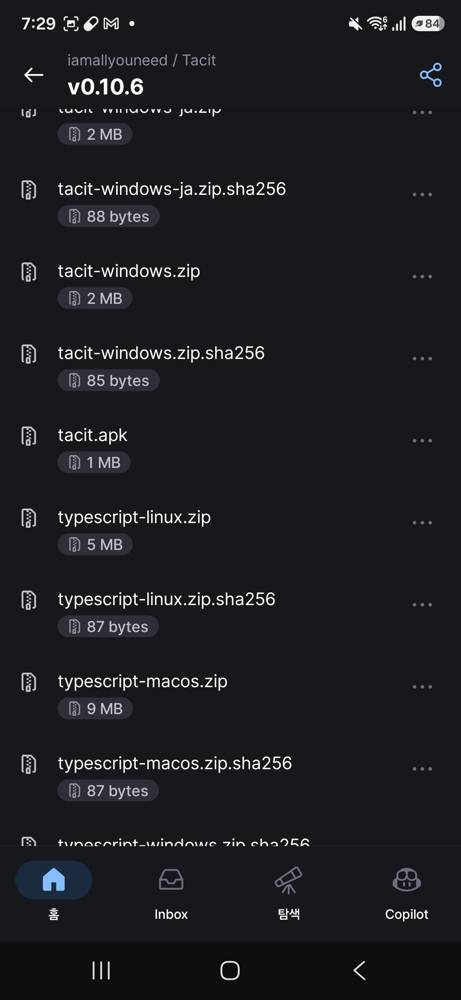
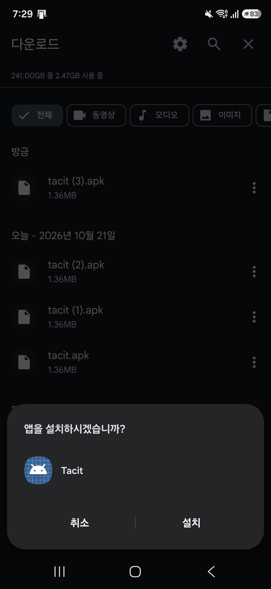
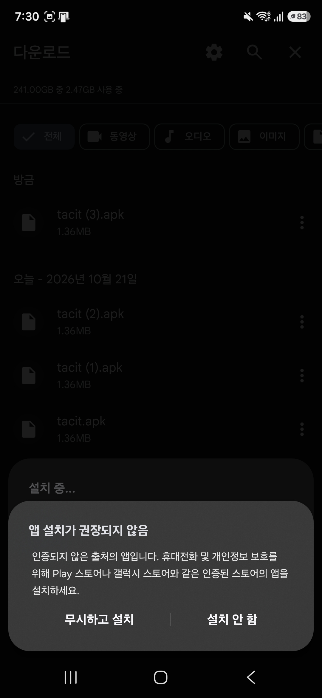
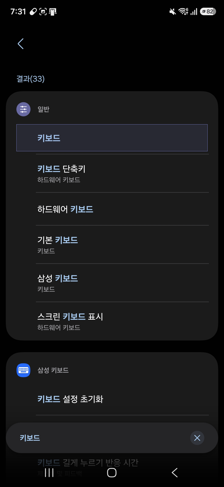
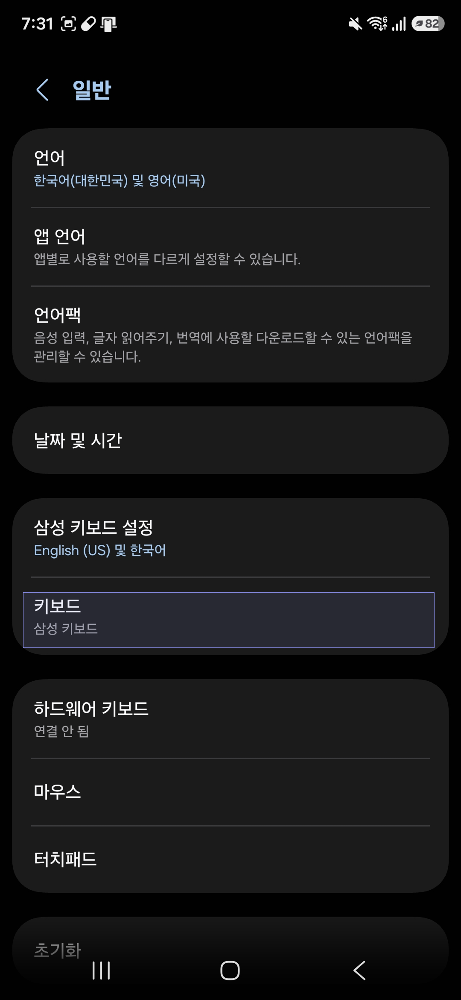
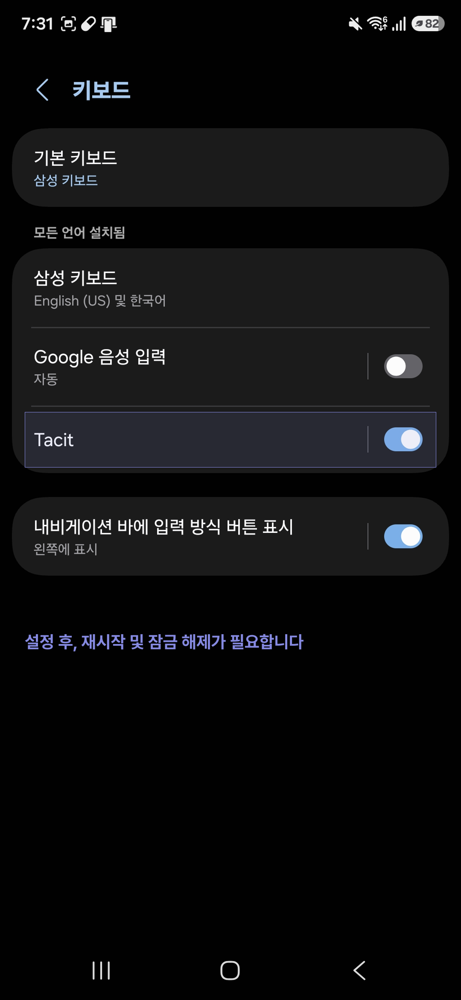
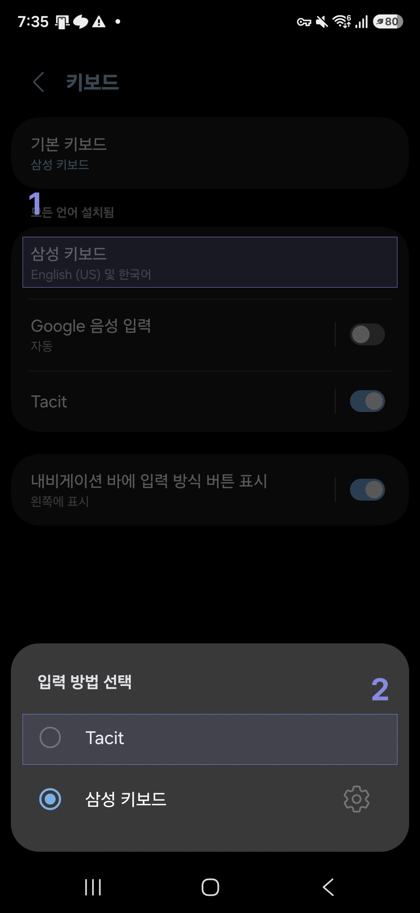
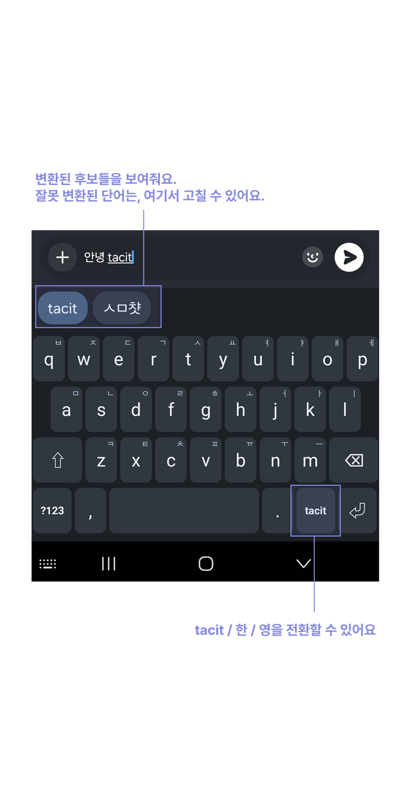

# Android 설치와 설정

화면 순서대로 따라 하면 됩니다. 화면은 삼성 기기 기준이고, 다른 제조사는 메뉴 이름이 조금 다를 수 있습니다.

## 1. 설치 파일 받기

폰 브라우저에서 [릴리스 페이지](https://github.com/iamallyouneed/Tacit/releases/latest)를 열고, 파일 목록에서 **`tacit.apk`** 를 눌러 받습니다. 용량은 약 1MB입니다.

> 릴리스 APK는 arm64 폰용입니다. x86_64 에뮬레이터에는 설치되지 않습니다.

## 2. 설치하기

받은 파일은 **내 파일 → 다운로드**에 있습니다. `tacit.apk` 를 열고 **설치**를 누릅니다.

처음에는 출처를 알 수 없는 앱 설치를 허용하라는 안내가 뜰 수 있습니다. 그러면 허용한 뒤 다시 설치합니다.

## 3. 경고는 "무시하고 설치"

Play 스토어 밖에서 받은 앱이라 "앱 설치가 권장되지 않음" 경고가 뜹니다. **무시하고 설치**를 누릅니다.

## 4. 키보드 설정 열기

**설정**에서 `키보드`를 검색하고 **일반 → 키보드**를 고릅니다.

**일반** 화면에서 **키보드**(현재 `삼성 키보드`)를 누릅니다.

## 5. Tacit 켜기

목록에서 **Tacit** 스위치를 켭니다. 이때 "설정 후, 재시작 및 잠금 해제가 필요합니다"라는 문구가 보이면, 화면을 한 번 잠갔다 풀어 주세요.

## 6. 키보드를 Tacit으로 바꾸기

글자를 입력할 칸을 열면 키보드 아래쪽에 **키보드 모양 버튼**이 나옵니다(내비게이션 바 왼쪽). 누르면 **입력 방법 선택**이 뜨고, **Tacit** 을 고릅니다.

> 항상 Tacit만 쓰고 싶다면 **설정 → 일반 → 키보드 → 기본 키보드**를 Tacit으로 바꿉니다.

## 7. 사용하기

한/영 키 없이 그냥 칩니다. `안녕 tacit` 처럼 한글과 영어를 섞어도 알아서 판별합니다.

- **후보 띠(키보드 위)**: 입력 중인 단어를 어떻게 읽을 수 있는지 보여 줍니다. 잘못 판별했으면 알맞은 후보를 눌러 고칩니다. 고친 선택은 학습됩니다.
- **오른쪽 아래 모드 키**: 누를 때마다 `tacit` → `한` → `영` 순서로 바뀝니다.
  - `tacit`: 자동 판별(기본)
  - `한`: 모든 단어를 한글로
  - `영`: 판별 없이 영어로
  
  모드는 입력창마다 `tacit`으로 시작합니다.

## 업데이트와 삭제

- **업데이트**: 새 릴리스의 `tacit.apk` 를 받아 같은 방식으로 설치하면 덮어씁니다. 설치가 실패하면 서명이 달라서이니, 앱을 삭제하고 다시 설치하세요.
- **삭제**: 설정 → 앱 → Tacit → 제거. 키보드 목록에서 Tacit을 끄고 다른 키보드를 기본으로 해 두면 안전합니다.