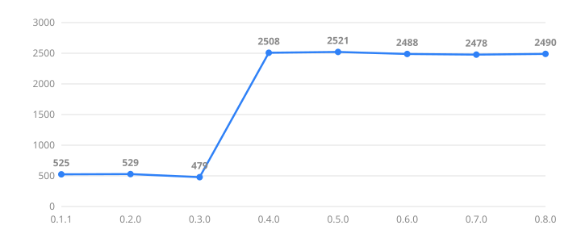

# 성능 리포트

릴리즈(부버전 이상)마다 크기·정확도·속도·메모리를 같은 방법으로 재서 위에서부터 쌓습니다. 맨 위 `## 한눈에`(직전 → 최신 비교)는 갈아끼우고, 그 아래에 새 버전 절을 둡니다.

<!-- score:begin -->
## 릴리즈 점수

정확도·용량·속도·메모리를 한 숫자로 합친 점수입니다(10000점 만점, 높을수록 좋음, 규격 v2, 계산기 `lab/score.py`).



최신 0.8.7은 **4121점**입니다. 그래프는 `.0` 릴리즈만 보여 줍니다(0.1.0은 태그가 없어 0.1.1로 대신).

<details><summary>모든 릴리즈의 점수와 세부 항</summary>

| 릴리즈 | 점수 | | L환율 | L예산 | L회귀 |
| --- | ---: | --- | ---: | ---: | ---: |
| 0.8.7 | 4121 | `████████████████████████` | 0.887 | 0.000 | 0.000 |
| 0.8.6 | 3050 | `██████████████████░░░░░░` | 1.187 | 0.000 | 0.000 |
| 0.8.5 | 2479 | `██████████████░░░░░░░░░░` | 1.395 | 0.000 | 0.000 |
| 0.8.4 | 2471 | `██████████████░░░░░░░░░░` | 1.398 | 0.000 | 0.000 |
| 0.8.3 | 2483 | `██████████████░░░░░░░░░░` | 1.393 | 0.000 | 0.000 |
| 0.8.2 | 2484 | `██████████████░░░░░░░░░░` | 1.393 | 0.000 | 0.000 |
| 0.8.1 | 2487 | `██████████████░░░░░░░░░░` | 1.391 | 0.000 | 0.000 |
| 0.8.0 | 2490 | `███████████████░░░░░░░░░` | 1.390 | 0.000 | 0.000 |
| 0.7.0 | 2478 | `██████████████░░░░░░░░░░` | 1.395 | 0.000 | 0.000 |
| 0.6.5 | 2474 | `██████████████░░░░░░░░░░` | 1.397 | 0.000 | 0.000 |
| 0.6.4 | 2486 | `██████████████░░░░░░░░░░` | 1.392 | 0.000 | 0.000 |
| 0.6.3 | 2491 | `███████████████░░░░░░░░░` | 1.390 | 0.000 | 0.000 |
| 0.6.2 | 2491 | `███████████████░░░░░░░░░` | 1.390 | 0.000 | 0.000 |
| 0.6.1 | 2491 | `███████████████░░░░░░░░░` | 1.390 | 0.000 | 0.000 |
| 0.6.0 | 2488 | `██████████████░░░░░░░░░░` | 1.391 | 0.000 | 0.000 |
| 0.5.2 | 2500 | `███████████████░░░░░░░░░` | 1.386 | 0.000 | 0.000 |
| 0.5.1 | 2513 | `███████████████░░░░░░░░░` | 1.381 | 0.000 | 0.000 |
| 0.5.0 | 2521 | `███████████████░░░░░░░░░` | 1.378 | 0.000 | 0.000 |
| 0.4.1 | 2429 | `██████████████░░░░░░░░░░` | 1.383 | 0.000 | 0.032 |
| 0.4.0 | 2508 | `███████████████░░░░░░░░░` | 1.348 | 0.000 | 0.035 |
| 0.3.0 | 479 | `███░░░░░░░░░░░░░░░░░░░░░` | 1.386 | 1.652 | 0.002 |
| 0.2.0 | 529 | `███░░░░░░░░░░░░░░░░░░░░░` | 1.373 | 1.567 | 0.000 |
| 0.1.1 | 525 | `███░░░░░░░░░░░░░░░░░░░░░` | 1.382 | 1.566 | 0.000 |

모든 릴리즈를 **같은 lab**(현재 커밋의 세트·데이터, 특히 held-out 용어 목록은 현재 팩 기준으로 고정)에 그 태그의 코어를 붙여 5회 중앙값으로 쟀고, 크기는 각 릴리즈의 GitHub 에셋(CI 빌드, 로컬 빌드보다 약 3% 큼)입니다. 그래서 아래쪽 0.8.6, 0.8.7 절(로컬 빌드, 그때의 lab)로 계산한 값과 다릅니다. 0.3.0 이하는 팩 구조 이전이라 `make_engine` 호출 모양만 맞춰 같은 lab에 붙였고 `size.packs`는 0입니다. 0.2.1은 뺐습니다. 점수 ±2% 이내 차이는 잡음입니다.

</details>
<!-- score:end -->

## 측정 방법

```sh
cargo build --release -p typescript-tip -p typescript-cli -p typescript-config
cargo build --release -p typescript-tip --target i686-pc-windows-msvc
powershell -File scripts/package.ps1          # dist/ 에 릴리즈와 같은 zip
python lab/fetch_data.py                      # 처음 한 번 (큰 세트용 데이터, git에 안 들어감)
sh lab/report.sh > section.md                 # 맨 위 한눈에 교체 + 새 버전 절
```

- 크기는 릴리즈 워크플로(`release.yml`)와 같은 빌드의 산출물입니다. x64 TIP이 큰 건 같이 빌드한 `typescript-cli`가 영어·한국어 팩을 내장시키기 때문이고(기능 통합), x86 TIP은 팩 없이 따로 빌드됩니다.
- 정확도는 `lab/`의 세트입니다. `acc.*`는 단어 단위(직접 고른 목록 포함), `big.*`는 실제 문장·제목에서 만든 큰 세트입니다. `sentence`는 문장 전체가 맞아야 맞고, `token`은 단어 하나씩 셉니다. 자세한 건 `lab/src/main.rs`와 `lab/src/corpus.rs`에 있습니다.
- 속도는 결정 한 번(`commit`)과 키 입력 한 번(`keystroke`)의 마이크로초이고, 5회 중앙값입니다. 같은 컴퓨터에서도 백그라운드 작업에 따라 10~20% 흔들리므로 릴리즈 사이의 작은 차이는 잡음으로 봅니다.
- 메모리는 팩을 올린 뒤 힙(`heap.loaded_kb`)과 측정 중 최대 힙(`heap.peak_kb`)입니다.
- **이전 버전과 비교할 때는 같은 lab으로 잽니다.** 세트와 데이터가 달라지면 같은 코드도 수치가 달라집니다. 새 worktree 둘을 만들어 한쪽에만 `git restore --source=<이전 태그> --worktree --staged crates/core`를 하고(코어에 없는 API를 쓰는 `lab/src/tune.rs` 같은 파일은 그 worktree에서만 비활성으로 바꿉니다), 각각 `lab/data`를 **복사**해 두고 5회씩 돌려 중앙값을 냅니다. `lab/data`를 junction이나 링크로 연결한 worktree를 `git worktree remove --force` 하면 링크 너머의 실제 데이터까지 지워집니다.

## 한눈에: 0.8.6 → 0.8.7

0.8.7은 용어 뒤 조사 붙음이 96.02 → 98.01%, 개발 시나리오 문장이 96.97 → 98.48%, 전체 시나리오 문장이 96.22 → 98.92%로 올랐고, commit 결정 지연은 절반 이하(26.2 → 12.0µs), 크기는 1% 안팎 증가·팩 동일. 내려간 것은 영어 단어 2개(`chandi`, `fatso`)뿐입니다(`acc.en.freq`).

**두 열은 같은 방법으로 잰 값입니다.** 같은 커밋의 lab(세트·데이터 동일)에 0.8.6 코어와 0.8.7 코어를 각각 붙여 같은 기계에서 5회 중앙값을 냈습니다. 크기는 두 릴리즈의 빌드 산출물입니다.

▲ 좋아짐 · ▼ 나빠짐 · = 동점/잡음(정확도 0.05%p, 지연 25% 안은 잡음으로 봄). 정확도는 높을수록, 크기·지연·메모리는 낮을수록 좋음.

### 정확도 핵심 (%)

| 지표 | 0.8.6 | 0.8.7 | 변화 |
| --- | ---: | ---: | ---: |
| `acc.ALL` | 99.82 `████████████` | 99.81 `████████████` | -0.01 = |
| `acc.en.freq/none` | 99.60 `████████████` | 99.50 `████████████` | -0.10 ▼ |
| `acc.en.freq/after-ko` | 99.45 `████████████` | 99.40 `████████████` | -0.05 = |
| `acc.ko.words/none` | 99.95 `████████████` | 100.00 `████████████` | +0.05 = |
| `acc.ko.vocab/none` | 100.00 `████████████` | 100.00 `████████████` | +0.00 = |
| `big.ko.sent.sentence` | 97.27 `██████████░░` | 98.43 `███████████░` | +1.16 ▲ |
| `big.ko.sent.token` | 99.46 `████████████` | 99.70 `████████████` | +0.24 ▲ |
| `big.ko.phrase.sentence` | 98.67 `███████████░` | 98.87 `███████████░` | +0.20 ▲ |
| `big.ko.long.sentence` | 94.60 `█████████░░░` | 97.00 `██████████░░` | +2.40 ▲ |
| `big.en.sent.sentence` | 99.97 `████████████` | 99.97 `████████████` | +0.00 = |
| `big.cs.particle.sentence` | 96.02 `██████████░░` | 98.01 `███████████░` | +1.99 ▲ |
| `big.cs.particle.token` | 99.38 `████████████` | 99.70 `████████████` | +0.32 ▲ |
| `big.cs_heldout.particle.sentence` | 95.32 `█████████░░░` | 97.78 `███████████░` | +2.46 ▲ |
| `big.cs.bare.sentence` | 95.42 `█████████░░░` | 97.18 `██████████░░` | +1.76 ▲ |
| `big.cs.number.sentence` | 97.51 `███████████░` | 98.81 `███████████░` | +1.30 ▲ |
| `big.ko.title.none` | 99.80 `████████████` | 99.87 `████████████` | +0.07 ▲ |
| `big.ko.title.after-en` | 98.00 `███████████░` | 98.03 `███████████░` | +0.03 = |
| `big.learn.other_forms_before` | 100.00 `████████████` | 100.00 `████████████` | +0.00 = |
| `big.learn.other_forms_after` | 100.00 `████████████` | 100.00 `████████████` | +0.00 = |

정확도 막대는 80~100% 구간. `acc.en.freq/none`의 -0.10은 `chandi`→`chan야`, `fatso`→`fat내` 두 단어이고, 영어+한국어를 한 번의 점수로 나누는 변경(`46d74a1`)부터입니다. 사전에 없는 단어 + `야`·`내`와 사전에 없는 영어 단어를 점수만으로는 가르지 못하는 한계이고, 앞부분 벌점을 시도했으나 `cs.particle`이 더 내려가 접었습니다([trial.md](trial.md)).

### 유형별 시나리오 문장 정답률 (%, 높을수록 좋음, 막대 80~100 구간)

| 유형 | 0.8.6 엔진 | 개선 후 | 변화 |
| --- | ---: | ---: | ---: |
| `chat` | 96.88 `██████████░░` | 98.44 `███████████░` | +1.56 ▲ |
| `dev` | 96.97 `██████████░░` | 98.48 `███████████░` | +1.51 ▲ |
| `writing` | 94.55 `█████████░░░` | 100.00 `████████████` | +5.45 ▲ |
| `전체` | 96.22 `██████████░░` | 98.92 `███████████░` | +2.70 ▲ |

시나리오도 같은 세트에 두 코어를 돌린 값입니다.

### 크기 비교 (KiB, 낮을수록 좋음, 막대 표 안 최대 기준)

| 항목 | 0.8.6 | 0.8.7 | 변화 |
| --- | ---: | ---: | ---: |
| `typescript_tip.dll` (x64) | 3435 `███████░░░░░` | 3460 `███████░░░░░` | +25 (+0.7%) ▼ |
| `typescript_tip.dll` (x86) | 704 `█░░░░░░░░░░░` | 724 `█░░░░░░░░░░░` | +20 (+2.8%) ▼ |
| `typescript.exe` | 3081 `██████░░░░░░` | 3110 `██████░░░░░░` | +29 (+0.9%) ▼ |
| `typescript-config.exe` | 5765 `████████████` | 5793 `████████████` | +28 (+0.5%) ▼ |
| `typescript-windows.zip` | 5036 `██████████░░` | 5069 `███████████░` | +33 (+0.7%) ▼ |
| `typescript-pack-en-0.8.7.zip` | 446 `█░░░░░░░░░░░` | 446 `█░░░░░░░░░░░` | 0 = |
| `typescript-pack-ko-0.8.7.zip` | 387 `█░░░░░░░░░░░` | 387 `█░░░░░░░░░░░` | 0 = |
| `typescript-pack-ja-0.8.7.zip` | 4763 `██████████░░` | 4763 `██████████░░` | 0 = |

### 지연 비교 (µs 중앙값, 낮을수록 좋음, 막대 표 안 최대 기준)

| 항목 | 0.8.6 | 0.8.7 | 변화 |
| --- | ---: | ---: | ---: |
| `commit.avg_us` | 26.19 `████░░░░░░░░` | 11.99 `██░░░░░░░░░░` | -14.20 (-54.2%) ▲ |
| `commit.p50_us` | 23.80 `████░░░░░░░░` | 10.50 `██░░░░░░░░░░` | -13.30 (-55.9%) ▲ |
| `commit.p95_us` | 55.60 `████████░░░░` | 22.30 `███░░░░░░░░░` | -33.30 (-59.9%) ▲ |
| `commit.p99_us` | 79.80 `████████████` | 44.20 `███████░░░░░` | -35.60 (-44.6%) ▲ |
| `keystroke.avg_us` | 15.12 `██░░░░░░░░░░` | 11.74 `██░░░░░░░░░░` | -3.38 (-22.4%) = |
| `keystroke.p50_us` | 9.70 `█░░░░░░░░░░░` | 9.40 `█░░░░░░░░░░░` | -0.30 (-3.1%) = |
| `keystroke.p95_us` | 38.70 `██████░░░░░░` | 25.90 `████░░░░░░░░` | -12.80 (-33.1%) ▲ |
| `keystroke.p99_us` | 58.40 `█████████░░░` | 60.70 `█████████░░░` | +2.30 (+3.9%) = |

### 시작·메모리 비교 (낮을수록 좋음, 막대 행별 비교)

| 항목 | 0.8.6 | 0.8.7 | 변화 |
| --- | ---: | ---: | ---: |
| `load.ms` | 3.21 `████████████` | 2.90 `███████████░` | -0.31 (-9.7%) = |
| `heap.loaded_kb` | 66.70 `████████████` | 35.67 `██████░░░░░░` | -31.03 (-46.5%) ▲ |
| `heap.peak_kb` | 7995.71 `████████████` | 7968.90 `████████████` | -26.81 (-0.3%) = |

지연·로드는 같은 기계에서도 10~20% 흔들리므로 작은 차이는 잡음으로 본다. 이전 보고서의 0.8.6 열은 다른 날 잰 값이라 keystroke 지연이 올라간 것처럼 보였지만, 같은 방법으로 다시 재면 p50 9.7 → 9.4µs, p99 58.4 → 60.7µs로 차이가 없습니다.

## 0.8.7

commit 9527580(정확도·속도는 커밋된 lab으로 재측정), 2026-10-16, rustc 1.93.1 (01f6ddf75 2026-02-11)

### 크기 (KiB)

| 항목 | KiB |
| --- | ---: |
| `typescript_tip.dll` (x64) | 3460 |
| `typescript_tip.dll` (x86) | 724 |
| `typescript.exe` | 3110 |
| `typescript-config.exe` | 5793 |
| `typescript-windows.zip` | 5069 |
| `typescript-pack-en-0.8.7.zip` | 446 |
| `typescript-pack-ko-0.8.7.zip` | 387 |
| `typescript-pack-ja-0.8.7.zip` | 4763 |

### 정확도 (%)

| 세트 | 정확도 |
| --- | ---: |
| `acc.ALL` | 99.81 |
| `acc.en.freq/none` | 99.50 |
| `acc.en.freq/after-ko` | 99.40 |
| `acc.ko.words/none` | 100.00 |
| `acc.ko.vocab/none` | 100.00 |
| `big.ko.sent.sentence` | 98.43 |
| `big.ko.sent.token` | 99.70 |
| `big.ko.phrase.sentence` | 98.87 |
| `big.ko.long.sentence` | 97.00 |
| `big.en.sent.sentence` | 99.97 |
| `big.cs.particle.sentence` | 98.01 |
| `big.cs.particle.token` | 99.70 |
| `big.cs_heldout.particle.sentence` | 97.78 |
| `big.cs.bare.sentence` | 97.18 |
| `big.cs.number.sentence` | 98.81 |
| `big.ko.title.none` | 99.87 |
| `big.ko.title.after-en` | 98.03 |
| `big.learn.other_forms_before` | 100.00 |
| `big.learn.other_forms_after` | 100.00 |

### 유형별 시나리오 (문장 정답률 %, token은 단어 단위, chain은 4문장 이어 입력)

| 유형 | 문장 | token | chain.token | µs/글자 |
| --- | ---: | ---: | ---: | ---: |
| chat | 98.44 | 99.47 | 99.47 | 3.65 |
| dev | 98.48 | 99.54 | 99.53 | 3.71 |
| writing | 100.00 | 100.00 | 100.00 | 3.51 |
| 전체 | 98.92 | 99.71 | | |

| 시나리오 | 문장 정답률 |
| --- | ---: |
| `chat.brand` | 100.00 |
| `chat.casual` | 100.00 |
| `chat.english` | 100.00 |
| `chat.loan` | 100.00 |
| `chat.number` | 100.00 |
| `chat.punct` | 100.00 |
| `chat.slang` | 90.91 |
| `dev.commit` | 100.00 |
| `dev.error` | 100.00 |
| `dev.identifier` | 100.00 |
| `dev.issue` | 100.00 |
| `dev.review` | 100.00 |
| `dev.terminal` | 94.12 |
| `dev.tool` | 100.00 |
| `writing.academic` | 100.00 |
| `writing.email` | 100.00 |
| `writing.english` | 100.00 |
| `writing.essay` | 100.00 |
| `writing.formal` | 100.00 |
| `writing.long` | 100.00 |
| `writing.numbers` | 100.00 |
| `writing.quote` | 100.00 |

### 속도·메모리 (중앙값, 5회)

| 항목 | 값 |
| --- | ---: |
| `commit.avg_us` | 11.99 |
| `commit.p50_us` | 10.50 |
| `commit.p95_us` | 22.30 |
| `commit.p99_us` | 44.20 |
| `keystroke.avg_us` | 11.74 |
| `keystroke.p50_us` | 9.40 |
| `keystroke.p95_us` | 25.90 |
| `keystroke.p99_us` | 60.70 |
| `load.ms` | 2.90 |
| `heap.loaded_kb` | 35.67 |
| `heap.peak_kb` | 7968.90 |

이번 릴리즈에서 시도하고 접은 것(연쇄 재채점, 한국어 언어모델, 기술 용어 trigram 등)과 수치는 [trial.md](trial.md)에 있습니다.

### 0.8.6 → 0.8.7: 유형별 시나리오 측정과 첫 고도화

측정에 유형별 시나리오를 더했습니다(`lab/scenarios/{chat,dev,writing}.tsv`, 대화 64·개발 66·글쓰기 55문장, 시나리오 태그별). 문장 하나씩(`sentence`, `token`)과 같은 유형 4문장을 이어 입력한 경우(`chain.token`, 앞 단어의 언어가 다음 단어로 이어지는 상황)를 잽니다. 직접 쓴 문장이라 편향이 있고, 틀린 것을 일감으로 쓰는 세트입니다. 아래는 같은 세트를 0.8.6 코어와 0.8.7 코어에 돌린 값입니다.

| 유형 | 문장 (0.8.6 → 후) | token (0.8.6 → 후) | chain.token (0.8.6 → 후) |
| ---- | ----------------: | -----------------: | -----------------------: |
| 대화 (chat)     | 96.88 → 98.44 | 98.95 → 99.47 | 99.47 → 99.47 |
| 개발 (dev)      | 96.97 → 98.48 | 99.08 → 99.54 | 99.06 → 99.53 |
| 글쓰기 (writing) | 94.55 → 100.00 | 98.98 → 100.00 | 99.61 → 100.00 |
| 전체           | 96.22 → 98.92 | 99.00 → 99.71 | |

시나리오별로 크게 달라진 것: 개발 `identifier` 85.7 → 100(`isValid가`), 글쓰기 `numbers` 62.5 → 100(`2024년`, `1.5kg이다`), 대화 `slang` 81.8 → 90.9.

고친 것:
- 숫자 바로 뒤의 단어: `년월일시분초개명원번살층대권`은 한국어(`2024sus` → `2024년`), `kg`, `gb`, `ms` 같은 단위는 영어(`1.5kgdlek` → `1.5kg이다`).
- camelCase 식별자 뒤 조사(`isValidrk` → `isValid가`).
- 사전에 없던 개발 도구 이름 약 60개(`graphql`, `mongodb`, `kubectl`, `timeout`, `sql`, `ssh` …). 한글 단어로도 읽히는 `dns`(운), `tls`(신)는 일부러 뺐습니다.

사전에 단어를 더하면 `terms.txt` 기반 세트가 부풀려지므로, 사전에 올리지 않은 단어만으로 따로 잰 값(`big.cs_heldout.particle.sentence`)을 같이 봅니다.

| 세트 | 0.8.6 | 후 |
| ---- | ----: | --: |
| `big.cs.particle.sentence` (전체 용어) | 96.02 | 98.01 |
| `big.cs_heldout.particle.sentence` (사전에 없는 용어만) | 95.32 | 97.78 |
| `big.ko.sent.sentence` | 97.10 | 97.23 |
| `acc.ALL` | 99.81 | 99.82 |

아직 못 고친 것(다음 일감):
- 문장 맨 앞의 두 자음 슬랭 `ㄴㄴ`(`ss`), `ㅁㅊ`(`ac`): 영어 약어와 구분할 근거가 없습니다(대화 `slang` 81.8%).
- 하이픈 뒤 옵션 `grep -rn` → `-구`: 직전 글자(`-`)를 엔진에 알려야 하고 세션 쪽 변경이 큽니다(개발 `terminal` 94.1%).
- 문장 시작의 `rm`(→그), `cp`(→체), 한글로 읽히는 `dns`, `tls`.

## 0.8.6

기준 커밋 d556020(+릴리즈 준비), 2026-10-16, rustc 1.93.1. 영어 팩의 쓰지 않던 빈도 열 제거, 한국어 음절 표 공유, 코어 엔진 `opt-level = "s"` 빌드, `cd` 영어 처리가 들어간 뒤의 첫 측정입니다.

### 크기 (KiB)

| 항목                            |  KiB |
| ------------------------------- | ---: |
| `typescript_tip.dll` (x64)      | 3435 |
| `typescript_tip.dll` (x86)      |  704 |
| `typescript.exe`                | 3081 |
| `typescript-config.exe`         | 5765 |
| `typescript-windows.zip` (설치) | 5036 |
| `typescript-pack-en-0.8.6.zip`  |  446 |
| `typescript-pack-ko-0.8.6.zip`  |  387 |
| `typescript-pack-ja-0.8.6.zip`  | 4763 |

### 정확도 (%)

| 세트                           | 정확도 |
| ------------------------------ | -----: |
| `acc.ALL` (직접 고른 전체)     |  99.81 |
| `acc.en.freq/none`             |  99.60 |
| `acc.en.freq/after-ko`         |  99.45 |
| `acc.ko.words/none`            |  99.95 |
| `acc.ko.vocab/none`            | 100.00 |
| `big.ko.sent.sentence`         |  97.10 |
| `big.ko.sent.token`            |  99.45 |
| `big.en.sent.sentence`         |  99.97 |
| `big.cs.particle.sentence`     |  86.82 |
| `big.cs.particle.token`        |  98.08 |
| `big.cs.bare.sentence`         |  95.66 |
| `big.cs.number.sentence`       |  96.95 |
| `big.ko.title.none`            |  99.87 |
| `big.ko.title.after-en`        |  98.57 |
| `big.learn.other_forms_before` |  87.50 |
| `big.learn.other_forms_after`  |  98.21 |

### 속도·메모리 (중앙값, 5회)

| 항목               |       값 |
| ------------------ | -------: |
| `commit.avg_us`    |    23.85 |
| `commit.p50_us`    |    20.10 |
| `commit.p95_us`    |    51.00 |
| `commit.p99_us`    |   101.70 |
| `keystroke.avg_us` |    13.90 |
| `keystroke.p50_us` |     8.90 |
| `keystroke.p95_us` |    34.10 |
| `keystroke.p99_us` |    63.40 |
| `load.ms`          |     1.90 |
| `heap.loaded_kb`   |    66.70 |
| `heap.peak_kb`     |  7995.82 |

### 이전과 비교 (이번 작업 전 `6c5ba4d`, 같은 lab 세트)

릴리즈 전에 따로 잰 값입니다. 다음 릴리즈부터는 위와 같은 표끼리 비교합니다.

| 항목                                    |    이전 |  0.8.6 |
| --------------------------------------- | ------: | -----: |
| `big.ko.sent.sentence` (%)              |   96.83 |  97.10 |
| `big.cs.particle.sentence` (%)          |   85.78 |  86.82 |
| `big.cs.bare.sentence` (%)              |   95.20 |  95.66 |
| `big.learn.other_forms_after` (%)       |   87.50 |  98.21 |
| 로드 직후 힙 (KiB)                      |    1006 |     67 |
| 최대 힙 (MiB)                           |     9.3 |    8.0 |
| 영어 팩 (MiB)                           |    1.58 |   1.44 |
| `commit` 평균 (µs, 같은 날 같은 조건)   |    ≈19 |    ≈20 |

- 정확도는 이미 97% 안팎이던 실데이터에서 소폭 올랐고, 직접 고른 목록(letter-noun 0 → 95%)에서 크게 올랐습니다. 학습 시뮬레이션은 한 형태를 가르친 뒤 다른 활용형이 87.5%에서 98.2%로 올랐습니다.
- 메모리와 크기는 줄었고, 결정 속도는 같거나 약간 느립니다(코어 `opt-level = "s"`로 약 3%).
- 알려진 약점: `graphql을`, `mongodb를`, `kubectl하고`처럼 사전에 없는 IT 이름 뒤에 조사가 붙는 문장(`big.cs.particle.sentence`의 나머지 13%).
